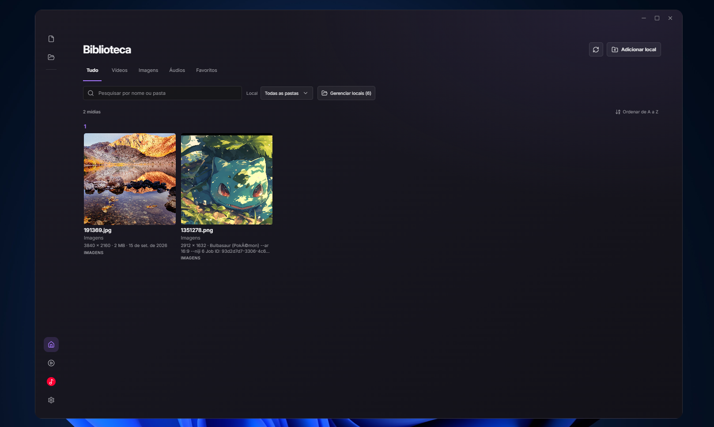

# Tocaê

Um espaço para reunir, organizar e aproveitar suas mídias.

O **Tocaê** é um reprodutor multimídia para Windows e Linux, desenvolvido para reunir músicas, vídeos e imagens em uma única aplicação.

Com uma interface minimalista e personalizável, permite explorar sua coleção, organizar arquivos, criar playlists e acessar serviços online, como o YouTube Music.

O projeto está em constante desenvolvimento, com foco em aprimorar a experiência de reprodução, ampliar as possibilidades de integração e incorporar recursos de inteligência artificial.



## Recursos

### Biblioteca multimídia

- **Biblioteca unificada:** reúna músicas, vídeos e imagens em um único ambiente.
- **Pastas personalizadas:** organize e navegue pelos diretórios de mídia.
- **Pesquisa rápida:** localize arquivos na biblioteca.
- **Favoritos:** marque e acesse seus conteúdos preferidos.
- **Informações detalhadas:** consulte informações dos arquivos e suas propriedades.

### Reprodução de mídia

- **Reprodução de áudio e vídeo:** suporte a diferentes formatos multimídia.
- **Vídeos verticais:** adaptação da reprodução para conteúdos em formato retrato.
- **Prévia na timeline:** visualize trechos do vídeo ao navegar pela linha do tempo.
- **Navegação precisa:** avance ou retroceda em intervalos de um segundo.
- **Visualizador musical:** acompanhe a reprodução de músicas com recursos visuais.
- **Visualização de imagens:** amplie, reduza e movimente imagens durante a visualização.

### Integrações online

#### YouTube Music

- **Acesso integrado:** utilize o YouTube Music diretamente no Tocaê.
- **Login persistente:** mantenha sua sessão entre utilizações.
- **Interface integrada:** acesse o serviço sem precisar alternar constantemente entre aplicações.
- **Separação de conteúdo:** mantenha os conteúdos do serviço independentes da biblioteca local.
- **Prioridade do áudio:** preserve a experiência de reprodução musical dentro da aplicação.

A integração utiliza a interface oficial do serviço. O Tocaê não extrai músicas, manipula cookies ou controla internamente a reprodução do YouTube Music.

### Inteligência artificial

O Tocaê inclui um assistente conversacional integrado ao processo principal do Electron.
Esta primeira versão utiliza um adaptador compatível com a API de Chat Completions
no formato OpenAI.

#### Configuração

1. Abra **Configurações > Assistente**.
2. Informe a URL base do provedor compatível e o modelo.
3. Informe a chave de API e use **Salvar chave**.

A chave é criptografada pelo `safeStorage` do Electron e armazenada fora do
Renderer, no diretório de dados do usuário. A configuração do provedor fica no
arquivo de preferências da aplicação. Não coloque credenciais no código-fonte,
em variáveis expostas ao Renderer ou em arquivos versionados.

A busca semântica usa o endpoint `/embeddings` do mesmo provedor. Configure um
modelo compatível com embeddings nas configurações do assistente. O índice é
gravado localmente em `ai-library-index.json` e atualizado quando a biblioteca
mudar. A primeira busca pode levar mais tempo enquanto o índice é criado.

Exemplo para o provedor oficial da OpenAI:

- URL base: `https://api.openai.com/v1`
- Modelo: `gpt-4o-mini`

Para desenvolvimento, execute `npm run dev`. A aplicação empacotada exige a
mesma configuração feita pelo usuário; não é necessário fornecer uma chave no
arquivo de distribuição.

O assistente suporta envio de mensagens, streaming de respostas, histórico
persistido localmente, cancelamento, timeout de 60 segundos e tratamento de
falhas. Nesta versão ele pode consultar a biblioteca e a fila por meio de
ferramentas somente leitura, incluindo metadados do item atual. O Teco também
pode iniciar, pausar, alternar ou avançar a reprodução por ferramentas
explícitas. Não altera arquivos nem executa ações fora da lista autorizada.

Entre as funcionalidades planejadas estão:

- **Assistente inteligente:** interaja com o Tocaê por meio de linguagem natural para encontrar e explorar conteúdos.
- **Busca semântica:** localize músicas, vídeos e imagens a partir de descrições e características do conteúdo.
- **Playlists inteligentes:** crie listas de reprodução considerando gêneros, estilos musicais, preferências e contexto.
- **Organização assistida:** receba sugestões para organizar a biblioteca e identificar informações ausentes.
- **Recomendações personalizadas:** descubra conteúdos relacionados às preferências e aos hábitos de reprodução.

Essas funcionalidades ainda estão em desenvolvimento. A disponibilidade dependerá da implementação e da evolução do módulo de inteligência artificial.

### Personalização

- **Cor de destaque:** personalize a identidade visual da aplicação.
- **Idiomas:** interface disponível em português (Brasil) e inglês.
- **Atalhos de teclado:** utilize comandos para agilizar a navegação e a reprodução.
- **Interface adaptável:** recursos organizados para diferentes necessidades de utilização.
- **Janela personalizada:** experiência visual integrada ao ambiente da aplicação.

## Formatos suportados

### Vídeos

`MP4` · `WebM` · `MKV` · `AVI` · `MOV` · `OGV`

### Áudios

`MP3` · `M4A` · `AAC` · `WAV` · `FLAC` · `OGG` · `Opus`

### Imagens

`JPG` · `PNG` · `APNG` · `GIF` · `WebP` · `BMP` · `AVIF`

A reprodução e a compatibilidade podem variar conforme o formato, o sistema operacional e os recursos disponíveis no ambiente.

## Desenvolvimento

### Requisitos

- Node.js 24 ou superior
- npm

### Instalação

Clone o repositório:

```bash
git clone https://github.com/joaomjbraga/tocae.git
```

Acesse o diretório:

```bash
cd tocae
```

Instale as dependências:

```bash
npm install
```

Inicie o ambiente de desenvolvimento:

```bash
npm run dev
```

### Scripts disponíveis

| Comando | Descrição |
|---|---|
| `npm run dev` | Inicia o ambiente de desenvolvimento |
| `npm run lint` | Executa a análise estática do código |
| `npm run test` | Executa os testes |
| `npm run typecheck` | Verifica os tipos |
| `npm run build:linux` | Gera a versão para Linux |
| `npm run build:windows` | Gera a versão para Windows |
| `npm run audit:release` | Executa verificações da versão de distribuição |

## Distribuição

O Tocaê possui configurações de empacotamento para os seguintes sistemas:

| Sistema | Formatos |
|---|---|
| Linux | `.deb` e `.rpm` |
| Windows | Instalador NSIS |

As versões de distribuição são disponibilizadas por meio das publicações do repositório no GitHub.

As atualizações são realizadas manualmente por meio das versões publicadas. O GitHub Actions executa verificações e processos de empacotamento para auxiliar na validação das entregas.

## Idiomas

- Português (Brasil)
- Inglês

## Projeto

O Tocaê é um projeto em desenvolvimento, construído com o objetivo de oferecer uma experiência multimídia integrada, combinando reprodução local, serviços online e, futuramente, recursos de inteligência artificial.

## Autor

**João M J Braga**

- GitHub: [@joaomjbraga](https://github.com/joaomjbraga)
- Projeto: [Tocaê](https://github.com/joaomjbraga/tocae)

---

**Tocaê** — suas mídias em um só lugar.